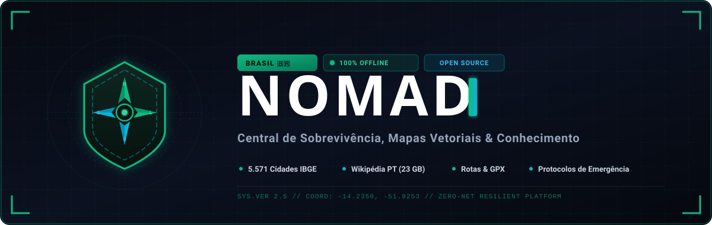

<p align="center">
  
</p>

<p align="center">
  <a href="https://dougpomp.github.io/nomad-brasil/"></a>
  <a href="LICENSE"></a>
  
  
  
</p>

> **Sistema autônomo e resiliente de mapas vetoriais nacionais, rotas táticas de evacuação, enciclopédia completa e 56 módulos de sobrevivência, primeiros socorros e resiliência para o Brasil.**  
> Projetado para operar com **zero dependência de internet**, funcionando diretamente em notebook, HD externo, pendrive ou servidor local de campo (Docker).  
> 🌐 **Demonstração Online no GitHub Pages (PWA):** [https://dougpomp.github.io/nomad-brasil/](https://dougpomp.github.io/nomad-brasil/)

---

## 🧭 Visão Geral

O **NOMAD Brasil** é uma plataforma *open source* criada para prover infraestrutura crítica de informação durante apagões prolongados, catástrofes climáticas, colapso de redes ou operações de campo em áreas remotas do território nacional.

O sistema integra em uma interface tática ultra-rápida em *dark mode*:
- **🗺️ Cartografia Vetorial Offline & Detalhe Urbano (`z=14` / Zoom 18):** Cobertura do Brasil inteiro via PMTiles (1,57 GB) com MapLibre GL JS sem depender de serviços externos, pré-carregamento em 1 clique das vias residenciais de qualquer cidade (`z=14`), cache persistente em disco, **régua tática** (distância, azimute real/magnético `-21°`, marcha e horizonte VHF/UHF), **anéis geodésicos de raio (2/5/10/25 km)**, **rastro GPS em tempo real (Breadcrumb)**, **filtro de Visão Noturna vermelha** e geocodificação reversa offline (Decimal, DMS, UTM e efemérides solar/lunar).
- **📍 Todos os 5.571 Municípios do IBGE + 416 mil+ Logradouros (SQLite FTS5):** Busca híbrida instantânea de cidades, ruas, avenidas, rodovias (`ref`) e POIs com sinônimos brasileiros (`Av`/`Avenida`, `Dr`/`Doutor`, `15`/`XV`), Radar de Socorro próximo (`🚑 Socorro`), prioridade por proximidade e auto-aprendizado em SQLite.
- **🚗 Rotas Táticas Quádruplas (OSRM + Grafo A\* MVT Offline) + Importador GPX/KML:** Roteamento por rua ou município com **parada intermediária (`Via`)**, OSRM online, cache permanente em disco, **grafo A\* curva a curva 100% offline sobre tiles MVT locais (até 30 km)**, **POIs de apoio no corredor (5 km)**, importação de trilhas `.gpx`/`.kml`, exportação **GPX** e **Dossiê Tático A4 imprimível**.
- **📚 Estante Multi-ZIM Kiwix Integrada (11+ Acervos / 23+ GB):** Wikipédia PT, Wikivoyage PT, Wikibooks PT, Wikipédia Médica PT, NHS Medicines, CDC, FAS Military Medicine e Zimgit servidos na porta 8090 com catálogo `/api/kiwix/books`, **busca unificada simultânea `/api/kiwix/search`**, atalho Wikivoyage por município e busca médica + **Ficha de Triagem TCCC (MARCHE)** imprimível na aba de Emergências.
- **📡 Modo Acampamento / Rede Local (Mural LAN + QR Code), Estoque Real PEPS, Cofre AES-256-GCM & Backup Portátil:** **Mural de Operações compartilhado na LAN** (`/api/camp-board` em `storage/camp_board.json`), **Controle de Estoque Real com Alerta de Validade PEPS** (`/api/inventory` em `storage/supply_inventory.json`), **Cofre Criptografado da Família** (`AES-256-GCM` + `PBKDF2-SHA256` em `storage/encrypted_vault.json` via `/api/vault`), modal de conexão em rede local com QR Code SVG 100% offline, sincronização automática dos marcadores pessoais (`storage/user_waypoints.json`) e backup completo em `.JSON` (`Waypoints`, `PEF`, `Cofre Cifrado`, `BOB`, `PACE`, `TCCC`, `Estoque PEPS` e `Breadcrumb`).
- **🤖 Assistente IA Tático Offline (`Ollama qwen2.5:1.5b` + RAG Local Verificado):** Aba dedicada (`🤖 IA Tática Offline`) com presets leves selecionáveis (`qwen2.5:1.5b` recomendado ~1 GB, `llama3.2:1b`, `gemma3:1b`, `phi4-mini`, `gemma3:4b`), ativação opcional em 1 clique (`ativar-ia-nomad.bat` / `ativar-ia-nomad.sh`), download com barra de progresso em tempo real e **fallback determinístico RAG Local** nas bases verificadas (`emergencies.json`, `survival.json`, `radio_frequencies.json`, `venomous_animals.json`, `panc_plants.json`, estoque PEPS e Kiwix) mesmo quando o motor LLM estiver desligado.
- **🛠️ 56 Módulos Especializados:** Guias interativos, calculadoras técnicas e protocolos operacionais para todas as dimensões de sobrevivência e autossuficiência.

---

## 🛡️ Arsenal de Módulos (56 Ferramentas)

### 1. 🗺️ Cartografia, Navegação & Deslocamento
1. **Mapas Nacionais em Nível de Ruas (`z=14` sob Demanda & Zoom 18 + Visão Noturna + Breadcrumb):** Visualizador vetorial acelerado por GPU com camada de relevo, estradas, edificações, pré-carregamento urbano em lote (`z=14`), filtro monocromático vermelho noturno e gravação contínua de rastro GPS (`🛰️ Rastro`) exportável em `.gpx`.
2. **Busca Híbrida + Geocodificação Reversa Offline + Efemérides + Anéis de Raio:** Motor local `brazil-streets.sqlite` com sinônimos brasileiros, inspeção de qualquer ponto do mapa (**Decimal / DMS / UTM**), cálculo astronômico offline (**alvorada/crepúsculo, sol e fase lunar**), **Régua Tática (`📐 Medir`)** e **Anéis Geodésicos de Perímetro (`⭕ Raios` 2/5/10/25 km)**.
3. **Planejador de Rotas & Evacuação (OSRM + Grafo A\* Offline + Via + GPX/KML + Dossiê A4):** Autocomplete de ruas/cidades com parada intermediária (`Via`), cálculo offline curva a curva sobre tiles MVT locais, **POIs de segurança ao longo de 5 km do corredor**, **importador visual de trilhas `.gpx`/`.kml`**, exportação GPX e **impressão de Dossiê Tático A4**.
4. **Radar de Socorro Próximo, Waypoints Persistentes, Mural LAN & QR Code:** Escaneamento instantâneo de hospitais, bombeiros/SAMU, PRF, postos e água em raios de `10`, `25` ou `50 km`, marcadores salvos no servidor (`user_waypoints.json`), **Mural compartilhado na LAN (`camp_board.json`)**, backup completo em `.JSON` e QR Code offline.
5. **Bússola Digital & Orientação Natural:** Rumo magnético, orientação solar por sombra de vareta e método analógico do relógio.
6. **Navegação Celeste (Hemisfério Sul):** Localização do Sul verdadeiro pelo Cruzeiro do Sul e constelação de Órion.
7. **Topografia de Expedição & Triangulação:** Leitura de cartas topográficas, cálculo de declividade e triangulação com bússola.
8. **Calculadora de Marcha & Navegação:** Ritmo de marcha militar, equação de Tobler para desníveis e gasto calórico.
9. **Mecânica de Emergência & Desatolamento:** Técnicas de ancoragem com guincho, estepe enterrado (deadman anchor) e reparos em campo.

### 2. 🩹 Primeiros Socorros & Atendimento Pré-Hospitalar (APH)
10. **Protocolos Imediatos de Suporte Básico:** Guias passo a passo para RCP (Parada Cardíaca), Manobra de Heimlich, Queimaduras e Convulsões.
11. **Trauma Grave — Protocolo TCCC / MARCHE & Ficha de Triagem:** Aplicação de torniquete tático, curativo compressivo israelense, selo de tórax valvulado, combate à hipotermia e **Ficha de Atendimento de Campo TCCC** com cronômetro de torniquete, sinais vitais e impressão A4 para resgate.
12. **Animais Peçonhentos do Brasil:** Identificação visual, tipo de veneno (crotálico, botrópico, elapídico) e soro antiofídico correspondente para Jararaca, Cascavel, Surucucu, Coral, Escorpiões e Aranhas.
13. **Fraturas, Luxações & Tração Óssea:** Protocolo de redução e alinhamento com talas rígidas e tração cutânea com teste obrigatório de **PMS** (Pulso, Motricidade, Sensibilidade).
14. **Suturas & Tratamento de Feridas na Mata:** Técnicas de assepsia de campo, aproximação com tiras adesivas, pontos simples e curativos com mel puro.
15. **Odontologia de Emergência & APH Bucomaxilar:** Alívio imediato de pulpite aguda, reimplante de dente avulsionado e hemostasia oral.
16. **Cinotécnica & APH Veterinário Canino (K9):** Parâmetros vitais de cães de trabalho, contenção tática, estancamento e intoxicação canina.
17. **Estante Médica & Enciclopédica Multi-ZIM (11 Acervos Offline):** *Wikipédia Médica PT*, *NHS Medicamentos*, *CDC Doenças & Saúde*, *FAS Military Medicine* e *Guia Médico Compacto*, integrados com busca médica rápida na aba de Emergências, *Wikipédia PT Completa*, *Wikivoyage PT* e *Wikilivros PT*.

### 3. 📻 Telecomunicações, Rádio & Sinais de Emergência
18. **Central de Sinais de Socorro & Morse Ativo:** Sinalizador visual estroboscópico de tela, tradutor de texto para Morse e **sintetizador de áudio de 800 Hz** com trava de segurança anti-sobreposição.
19. **Frequências de Socorro do Brasil:** Frequências oficiais do Rádio Cidadão (PX Canal 9 - 27.065 MHz), VHF Marítimo (Canal 16 - 156.800 MHz), RENER (Defesa Civil) e Aviação (121.500 MHz).
20. **Calculadora de Antenas Dipolo:** Dimensionamento milimétrico de dipolos de meia onda utilizando fio comum de cobre.
21. **Código Q Oficial & Alfabeto ICAO:** Dicionário interativo com busca instantânea dos códigos de rádio operacionais.
22. **Sinais Terra-Ar para Resgate (SAR / ICAO):** Painéis e símbolos corporais para comunicação visual com aeronaves e helicópteros.
23. **Cifra Tática & Transmissão Segura:** Encriptação manual com Cifra de César, Cifra de Vigenère e bloco de uso único (One-Time Pad).
24. **Protocolo PACE de Comunicação:** Definição operacional das 4 camadas (Primary, Alternate, Contingency, Emergency) e janelas de escuta.
25. **Satélites Meteorológicos & Ciclo Lunar:** Previsão de passagens de satélites NOAA/GOES e tábua de luminosidade lunar.

### 4. 🌾 Resiliência Alimentar, Água & Agrofloresta
26. **Calculadora Tática de Racionamento & Inventário Real PEPS:** Dimensionamento exato de água (3 L/dia/pessoa), calorias totais e cesta padrão nacional, integrado ao **Controle de Estoque Real da Base** (`/api/inventory` em `storage/supply_inventory.json`) com alertas de validade (≤ 60 dias), comparação em barra de Água/Calorias Reais vs. Meta e inclusão automática no backup `.JSON`.
27. **Captação, Filtração & Cloração de Água:** Construção de biofiltros de areia/brita e tabela de dosagem de hipoclorito de sódio a 2,5%.
28. **Poço Caipira Manual & Carneiro Hidráulico:** Perfuração manual de poços rasos e montagem de bomba de carneiro sem energia elétrica.
29. **Plantas Alimentícias Não Convencionais (PANC):** Guia botânico de identificação e preparo de Ora-pro-nóbis, Taioba, Beldroega, Dente-de-leão e Caruru.
30. **Conservação Ancestral de Alimentos:** Defumação a frio/quente, cura com sal grosso, banha de porco (confit) e desidratação solar.
31. **Panificação Rústica & Fermentação Selvagem:** Cultivo e manutenção de fermento natural (*levain/sourdough*) e pães de panela de ferro.
32. **Apicultura Nativa & Abelhas Sem Ferrão (ASF):** Criação racional de espécies brasileiras (Jataí, Mandaçaia, Tiúba, Uruçu) e produção de mel medicinal.
33. **Piscicultura & Aquaponia Artesanal (IBC 1000L):** Criação sustentável de tilápias integrada ao cultivo de hortaliças em leito de brita.
34. **Banco de Sementes Crioulas & Hortas de Crise:** Métodos de coleta, secagem, armazenamento hermético em garrafas PET e plantio de subsistência.

### 5. ⚡ Energia, Infraestrutura & Sobrevivência Prática
35. **Calculadora Fotovoltaica Off-Grid:** Cálculo da potência de painéis solares (Wp), dimensionamento do banco de baterias e controlador MPPT.
36. **Baterias 18650 & Geradores Alternativos:** Recuperação de células de lítio, montagem de packs balanceados e geradores mecânicos.
37. **Gasogênio a Lenha (Wood Gas):** Fabricação de gasificador térmico para converter biomassa florestal em combustível de motores a pistão.
38. **Checklist de Mochila 72 Horas (BOB):** Inventário dinâmico dividido nas 7 linhas de resiliência com pesagem total em tempo real.
39. **Plano de Emergência Familiar (PEF) & Cofre Criptografado AES-256-GCM:** Definição de rotas primárias de fuga, pontos de encontro, senhas familiares e **Cofre Criptografado da Família** (`AES-256-GCM` + `PBKDF2-SHA256` 100.000 iterações via `/api/vault` e `storage/encrypted_vault.json`) para proteger documentos, dados médicos críticos, coordenadas de abrigo e frequências privadas — permanecendo cifrado também dentro do backup `.JSON`.
40. **Fogo em Condições Severas & Fogueira Dakota:** Técnicas de pederneira com fungo de árvore, fogo de atrito e buraco Dakota (chama invisível sem fumaça).
41. **Construção de Abrigos & Bioconstrução:** Técnicas de pau-a-pique, adobe, superadobe e abrigos rápidos de lona e folhagens.
42. **Manual Tático de Nós & Amarrações:** Nós de salvamento (Ás de Guia), tração (Caminhoneiro), junção (Nó de Escota) e pioneirias com bambu.
43. **Pesca & Armadilhas de Sobrevivência:** Arapucas para aves, laços de gatilho de mola e anzóis improvisados de osso/madeira.
44. **Meteorologia Empírica & Leitura de Nuvens:** Previsão do tempo sem barômetro através de nuvens cumulonimbus, névoa e comportamento animal.
45. **Sinais de Pista & Rastreamento Humano:** Identificação de passadas, leitura de compressão do solo e técnicas de contra-rastreamento.

### 6. 🛡️ Defesa Passiva, Proteção QBRN & Segurança
46. **Evasão Urbana & Conceito Gray Man:** Técnicas de blend-in civil, camuflagem comportamental e dispersão sem chamar atenção.
47. **Segurança Perimetral & Alertas de Intrusão:** Instalação de alarmes passivos de linha de tropeço (*tripwires* com espoleta/latinhas) e setores defensivos.
48. **Fortificação de Abrigos & Defesa Passiva:** Reforço de portas, barricadas de sacos de terra, blindagem balística e compartimentação de cômodos seguros.
49. **Gaiola de Faraday & Proteção EMP:** Construção de blindagens eletromagnéticas com caixas de munição e folhas de cobre para proteger rádios e baterias.
50. **Acidentes Radiológicos & Proteção QBRN:** Protocolos de blindagem radiológica (Tempo, Distância, Blindagem) e descontaminação pessoal.
51. **Biossegurança, Epidemias & Quarentena:** Protocolos de isolamento domiciliar, paramentação de proteção e saneamento básico de dejetos.
52. **Defesa Civil & Desastres Naturais do Brasil:** Procedimentos oficiais em inundações, enxurradas, deslizamentos de encostas e estiagens severas.

### 7. ⚒️ Oficinas Rústicas, Química & Ferramentaria
53. **Forja & Ferraria Rústica:** Montagem de forja de barro/tijolos, soprador de ar com ventoinha e têmpera de ferramentas em óleo.
54. **Cutelaria & Afiação de Campo:** Uso de pedras de rio, chairas e lixas para afiação de facões, machados e navalhas.
55. **Carvão Vegetal Ativado Medicinal & Filtros:** Pirólise controlada de cascas de coco/madeira e ativação com cloreto para uso antitóxico e em filtros.
56. **Química Prática & Sabão de Cinzas:** Saponificação tradicional utilizando lixívia de cinzas de madeira e gordura animal.
- **Cartão Tático de Bolso Imprimível (A4 Dobrável):** Folha única ultra-compacta contendo todas as frequências vitais, ficha médica, nós e protocolos de choque.
- **Pacote Portátil Offline:** Exportação compacta em arquivo único para armazenamento seguro em pen-drives criptografados.
- **Backup & Restauração Tática (.JSON):** Exportação e restauração portável de marcadores pessoais (Waypoints sincronizados no servidor), Plano de Emergência Familiar (PEF), Cofre Criptografado da Família (`AES-256-GCM`), Checklist da Mochila 72h (BOB), Plano de Comunicação PACE, Fichas TCCC, Inventário de Estoque Real (PEPS) e Rastro GPS (*Breadcrumb*).
- **Dossiê Tático de Movimento Imprimível (A4):** Ordem de Movimento gerada em 1 clique a partir da rota traçada com coordenadas Decimal/DMS/UTM de Origem, Parada (`Via`) e Destino, POIs de apoio até 5 km no corredor, passo a passo, estimativa de combustível/água/calorias, janela de luz solar no destino, PEF e plano PACE.
- **Modo Acampamento / Rede Local (LAN QR Code SVG):** Modal de compartilhamento local (`:8000` e `:8090`) com gerador nativo de QR Code SVG 100% offline (ISO-18004) para celulares e tablets na mesma rede Wi-Fi/hotspot.
- **Mural de Operações na Rede Local (`Camp Board LAN`):** Quadro compartilhado em disco (`storage/camp_board.json` via `/api/camp-board`) para postagem de alertas, QTH com salto direto no mapa, suprimentos, rádio QAP e logs de turno entre todos os dispositivos conectados no Wi-Fi/hotspot.
- **Importador Visual de Trilhas e Waypoints (`.GPX` / `.KML` / `.JSON`):** Carregamento direto de trilhas externas no mapa vetorial offline com cálculo de extensão total, marcadores de início/fim e importação automática de `<wpt>` e `<Placemark>`.
- **Anéis de Raio Tático (`2 / 5 / 10 / 25 km`), Rastro GPS (*Breadcrumb*) & Modo Visão Noturna:** Círculos geodésicos de perímetro com contagem de municípios e POIs de socorro, gravação contínua de trilha GPS exportável em `.gpx` e filtro monocromático vermelho (`🔴 Visão Noturna`) para preservar a adaptação visual no escuro.
- **Ficha de Atendimento de Campo & Cartão de Triagem TCCC (A4):** Registro persistente de vítimas com cronômetro de alerta de torniquete, escala AVPU, sinais vitais, lesões, condutas e impressão em folha A4 para entrega ao resgate.
- **Controle de Estoque Real & Alerta de Validade (Dispensa / Farmácia PEPS):** Gestão persistente em disco (`storage/supply_inventory.json` via `/api/inventory`) comparando água (L) e calorias (kcal) reais contra a meta planejada, com alertas automáticos de validade (`🟢 OK`, `🟡 ≤ 60 dias — Rodízio PEPS`, `🔴 Vencido`), importação em 1 clique da cesta calculada e ajuste rápido `+1`/`-1`.
- **Cofre Criptografado da Família (`AES-256-GCM` + `PBKDF2-SHA256` Offline):** Criptografia autenticada de 256 bits com derivação de chave por senha mestre (`100.000` iterações `PBKDF2-SHA256`, salt de 16 bytes e IV de 12 bytes) persistida em `storage/encrypted_vault.json` via `/api/vault` (com fallback transparente `/api/vault/crypto` em conexões HTTP na LAN), protegendo documentos, dados médicos críticos, coordenadas de refúgio, frequências privadas e notas sem jamais gravar texto aberto em disco ou no backup `.JSON`.
- **Assistente IA Tático Offline (`Ollama qwen2.5:1.5b` + RAG Local Verificado):** Consulta em português cruzando os protocolos validados do portal (`emergencies.json`, `survival.json`, `radio_frequencies.json`, `venomous_animals.json`, `panc_plants.json`), o estoque PEPS e sugestões Kiwix com modelos locais leves (`qwen2.5:1.5b` recomendado, `llama3.2:1b`, `gemma3:1b`, `phi4-mini`, `gemma3:4b`), incluindo barra de progresso no download (`/api/ai/pull`), fontes clicáveis e **fallback RAG Local** mesmo sem LLM ativo.

---

## ⚡ Instalação Rápida (1 Clique)

### No Windows:
1. Clone o repositório ou baixe os arquivos para o seu computador:
   ```cmd
   git clone https://github.com/DougPomp/nomad-brasil.git
   cd nomad-brasil
   ```
2. Execute o instalador automático com 2 cliques ou pelo terminal:
   ```cmd
   setup-nomad-brasil.bat
   ```
   *O instalador cria a estrutura de diretórios, baixa o mapa vetorial do Brasil (`brazil-streets.pmtiles`), gera automaticamente o índice local de ruas em SQLite FTS5 (`storage/maps/brazil-streets.sqlite`), oferece o download da Wikipédia Kiwix e inicia os contêineres Docker automaticamente.*

   Caso deseje reconstruir manualmente o índice de ruas offline a partir do arquivo `brazil-streets.pmtiles`:
   ```cmd
   docker run --rm -v "C:\nomad-brasil:/repo" node:22-slim node /repo/app/build_streets_index.js
   ```

3. Para inicializações diárias rápidas:
   ```cmd
   iniciar-nomad-brasil.bat
   ```
4. **(Opcional) Para ativar o Assistente IA Offline (Ollama + `qwen2.5:1.5b`, ~1,0 GB):**
   ```cmd
   ativar-ia-nomad.bat
   ```
   *Sobe automaticamente o perfil `ai` no Docker, baixa o modelo escolhido para `storage\ollama\` e faz o `iniciar-nomad-brasil.bat` reativar a IA automaticamente nos próximos inícios.*

### No Linux / macOS / Raspberry Pi:
```bash
git clone https://github.com/DougPomp/nomad-brasil.git
cd nomad-brasil
chmod +x setup-nomad-brasil.sh ativar-ia-nomad.sh
./setup-nomad-brasil.sh
# Opcional — ativar IA local offline (qwen2.5:1.5b):
./ativar-ia-nomad.sh
```
*O script também gera automaticamente o índice `storage/maps/brazil-streets.sqlite` (reconstruível via `docker run --rm -v "$(pwd):/repo" node:22-slim node /repo/app/build_streets_index.js`).*

---

## 🌐 Portas de Acesso Local

| Serviço | Endereço | Descrição |
| :--- | :--- | :--- |
| **Portal NOMAD Brasil** | [http://localhost:8000](http://localhost:8000) | Dashboard tático, mapa vetorial, rotas, IA RAG offline e 56 módulos de sobrevivência |
| **Biblioteca Kiwix** | [http://localhost:8090](http://localhost:8090) | Servidor e leitor nativo dos acervos ZIM da Wikipédia |
| **Ollama IA Offline (Opcional)** | `http://localhost:11434` | Motor LLM local ativado via `ativar-ia-nomad.bat` / `--profile ai` (pesos em `storage/ollama/`) |

---

## 🛠️ Arquitetura do Sistema

```
nomad-brasil/
├── app/
│   ├── build_streets_index.js  # Indexador nacional PMTiles -> SQLite FTS5 com 416k+ ruas e POIs
│   ├── server.js               # Servidor HTTP Node.js 22 com Range 206, busca FTS5 /api/streets, cofre AES-256, IA RAG /api/ai/*, cache z=14 e rotas
│   ├── data/
│   │   ├── cities.json         # Todos os 5.571 municípios do IBGE (UTF-8, DDD, Lat/Lng)
│   │   ├── emergencies.json    # Protocolos de atendimento pré-hospitalar
│   │   ├── pois.json           # POIs estratégicos (Hospitais, Bombeiros, PRF, Água, Postos)
│   │   ├── radio_frequencies.json # Frequências oficiais (PX, VHF, Marítimo, Código Q)
│   │   ├── survival.json       # Manuais técnicos de resiliência e campo
│   │   └── routes_cache/       # Cache permanente em disco de todas as rotas traçadas
│   └── public/
│       ├── index.html          # Interface tática em dark mode com os 56 módulos, IA Tática Offline, estante Multi-ZIM, Mural LAN, Estoque PEPS, Cofre AES-256, TCCC e Visão Noturna
│       ├── styles.css          # Design system com sidebar tática, grid responsivo, controles escuros e filtro de visão noturna
│       ├── app.js              # Mapas, reversa, prefetch z=14, rotas + Via, GPX/KML, anéis, breadcrumb, IA RAG/Ollama, Multi-ZIM, estoque PEPS, cofre AES-256, QR SVG, TCCC e A4
│       ├── sw.js               # Service Worker PWA (v19) para operação offline e Network-First nas APIs
│       ├── banner.svg          # Banner vetorizado da marca
│       ├── logo.svg            # Logotipo oficial
│       └── vendor/             # MapLibre GL e PMTiles 100% offline (zero CDNs)
├── docs/                       # Demonstração Web PWA no GitHub Pages
│   ├── index.html              # Showcase completo das ferramentas táticas + DMS/UTM + Multi-ZIM + QR LAN + Estoque PEPS + Cofre AES-256 + TCCC + Dossiê A4
│   ├── sw.js                   # Service Worker do GitHub Pages (v19)
│   ├── manifest.json           # Manifesto PWA instalável em smartphones e tablets
│   ├── banner.svg              # Imagem Open Graph / Twitter Card
│   └── logo.svg                # Favicon e ícones
├── storage/
│   ├── maps/
│   │   ├── brazil-streets.pmtiles      # Arquivo vetorial (1,57 GB, 1.186.952 tiles)
│   │   ├── brazil-streets.sqlite       # Índice SQLite FTS5 (WAL, ~48 MB, 416k+ vias + auto-aprendizado)
│   │   ├── detail_tiles_cache/         # Cache persistente em disco de tiles vetoriais z=14 (.pbf)
│   │   └── basemaps-assets/fonts/      # Glyphs Noto Sans locais
│   ├── user_waypoints.json             # Marcadores pessoais sincronizados automaticamente no servidor
│   ├── camp_board.json                 # Mural de operações compartilhado na rede local (Camp Board LAN)
│   ├── supply_inventory.json           # Inventário real de suprimentos e farmácia da base com controle de validade (PEPS)
│   ├── encrypted_vault.json            # Cofre criptografado da família (AES-256-GCM + PBKDF2-SHA256)
│   ├── ollama/                         # Pesos dos modelos LLM offline (ex.: qwen2.5:1.5b via perfil ai)
│   └── zim/                            # Biblioteca Multi-ZIM (Wikipédia, Wikivoyage, Wikibooks, Medicina, NHS, CDC, FAS)
│       ├── *.zim                       # 11+ acervos enciclopédicos e médicos offline
│       └── kiwix-library.xml           # Catálogo XML gerado
├── tools/                      # Utilitário go-pmtiles
├── docker-compose.yml          # Orquestração dos serviços (Web rw, Kiwix ro e Ollama opcional no perfil ai)
├── ativar-ia-nomad.bat         # Ativador de 1 clique da IA offline (Ollama + qwen2.5:1.5b) no Windows
├── ativar-ia-nomad.sh          # Ativador de 1 clique da IA offline no Linux/macOS
├── setup-nomad-brasil.bat      # Instalador e downloader automático para Windows
├── setup-nomad-brasil.sh       # Instalador e downloader automático para Linux/macOS
├── iniciar-nomad-brasil.bat    # Inicializador rápido portátil (auto-ativa perfil ai se houver modelos em storage\ollama)
└── README.md
```

---

## 🔍 Busca Nacional de Ruas, Pré-carregamento z=14 & Geocodificação Reversa

A pesquisa e inspeção de logradouros opera em 5 camadas integradas:
1. **Índice Local SQLite FTS5 (`brazil-streets.sqlite`):** Mais de **416.426** vias, rodovias (`ref`) e pontos de interesse extraídos de 184.493 tiles `z=13` cobrindo os 5.571 municípios brasileiros, com tokenização tolerante a acentos (`unicode61 remove_diacritics 2`), sinônimos brasileiros (`Av`↔`Avenida`, `Dr`↔`Doutor`, `15`↔`XV`) e ranking por proximidade ao centro atual do mapa.
2. **Inspeção Instantânea & Geocodificação Reversa Offline (`/api/streets/reverse`):** Clique em qualquer rua em zoom urbano (`>= 12.5`) ou clique com o botão direito em qualquer ponto do mapa para identificar a via mais próxima diretamente nos tiles locais (`brazil-streets.pmtiles` / `detail_tiles_cache`), ver coordenadas **Decimal / DMS / UTM** e acessar atalhos de rota, waypoint ou socorro próximo.
3. **Pré-carregamento Urbano por Cidade (`z=14` em 1 Clique):** No painel lateral da cidade selecionada, o botão **"Baixar Todas as Ruas da Cidade (Offline z=14)"** baixa em lote os tiles `z=14` ao redor do município via `/api/maps/prefetch-city`, salva em `storage/maps/detail_tiles_cache/` e indexa automaticamente todas as ruas residenciais no SQLite FTS5.
4. **Tiles Vetoriais de Detalhe sob Demanda (`z=14`):** Ao navegar por bairros no mapa, os tiles visitados também são persistidos e indexados em segundo plano.
5. **Descoberta Online Sob Demanda (`Photon` / `Nominatim`) com Persistência Offline:** Quando há conexão e uma rua residencial ainda não consta localmente, o backend consulta `Photon`/`Nominatim` e grava a via descoberta permanentemente no `brazil-streets.sqlite`.
6. **Efemérides Astronômicas Offline & Régua Tática (`📐 Medir`):** Cálculo matemático local de alvorada/crepúsculo civil, nascer/pôr do sol, duração do dia e fase/iluminação lunar por coordenada, além de medição multiponto no mapa com distância geodésica, azimute verdadeiro, azimute magnético (declinação média `-21°`), tempo de marcha e horizonte de linha de visada VHF/UHF.
7. **Anéis Geodésicos de Perímetro (`⭕ Raios`) & Rastro GPS (`🛰️ Rastro`):** Traçado de anéis concêntricos de `2`, `5`, `10` e `25 km` (ou raio customizado) com contagem automática de municípios e pontos de socorro no perímetro, somado ao gravador de trilha GPS em tempo real (*Breadcrumb*) com exportação `.gpx`.

---

## 🚗 Sistema de Rotas Táticas & Radar de Apoio

O sistema possui quádrupla camada de resiliência para cálculo de deslocamentos (entre municípios ou **porta a porta por rua/logradouro**) somada ao Radar de Socorro (`🚑 Socorro`):
1. **Camada 1 — Rodovias & Vias Urbanas Reais (Online/OSRM):** Traçado geográfico fiel às ruas locais e rodovias federais/estaduais com guia curva a curva.
2. **Camada 2 — Cache Permanente em Disco:** Qualquer rota pesquisada uma única vez é gravada localmente em `app/data/routes_cache/`.
3. **Camada 3 — Grafo A\* Offline sobre Tiles MVT Locais (até 30 km):** Sem internet e sem rota prévia em cache, o servidor extrai a malha viária dos tiles locais (`z=13` e `detail_tiles_cache` `z=14`) e calcula uma rota curva a curva real pelo algoritmo A\* com hierarquia viária.
4. **Camada 4 — Corredor Tático de Contingência:** Para trajetos intermunicipais inéditos acima de 30 km sem sinal, calcula o corredor com fator de curvatura nacional (`1,28x`) e municípios de apoio no percurso, mantendo exportação **GPX** universal para Garmin e OsmAnd.
5. **Parada Intermediária (`Via` — `viaLat`/`viaLng`/`viaLabel`):** Suporte a ponto intermediário tanto no motor OSRM quanto no grafo A\* 100% offline em 2 trechos sobre tiles MVT locais, com exportação de waypoint `<wpt>` no arquivo `.gpx`.
6. **Corredor de Segurança de 5 km (`corridorSupport`):** Escaneamento automático ao longo da geometria da rota identificando hospitais, bombeiros, polícia, postos de combustível e fontes de água até 5 km do eixo, com distância lateral e quilômetro da rota.
7. **Dossiê Tático da Rota Imprimível em A4 (`printCurrentRouteDossier`):** Geração de Ordem de Movimento em folha A4 pronta para impressão ou salvamento offline em HTML.
8. **Importador de Trilhas e Rotas Externas (`.GPX` / `.KML`):** Leitura 100% local de arquivos `.gpx` e `.kml` de aparelhos Garmin, OsmAnd ou equipes de campo, desenhando a geometria da trilha sobre o mapa vetorial e importando seus waypoints.

---

## 📚 Estante Multi-ZIM Kiwix (11 Acervos Suportados)

| Arquivo `.zim` (`storage/zim/`) | Título no Portal | Categoria | Tamanho |
| :--- | :--- | :--- | :--- |
| `wikipedia_pt_all_maxi_2026-05.zim` | 🌐 Wikipédia PT Completa | `wikipedia` | 19,2 GB |
| `wikipedia_pt_top_maxi_2026-10.zim` | 📚 Wikipédia PT Top | `wikipedia` | 2,8 GB |
| `wikipedia_pt_medicine_maxi_2026-10.zim` | 🩺 Wikipédia Médica PT | `medicine` | 281 MB |
| `wikivoyage_pt_all_maxi_2026-09.zim` | 🧭 Wikivoyage PT (Guias) | `travel` | 54 MB |
| `wikibooks_pt_all_maxi_2026-10.zim` | 📖 Wikilivros / Manuais PT | `books` | 162 MB |
| `fas-military-medicine_en_2025-06.zim` | 🩹 FAS Military Medicine | `medicine` | 78 MB |
| `nhs.uk_en_medicines_2025-12.zim` | 💊 NHS Medicamentos | `medicine` | 16 MB |
| `wwwnc.cdc.gov_en_all_2024-11.zim` | ☣️ CDC Doenças & Saúde | `medicine` | 170 MB |
| `zimgit-medicine_en_2024-08.zim` | 🏥 Guia Médico Compacto | `medicine` | 67 MB |
| `wikipedia_en_top_mini_2026-06.zim` | 🌍 Wikipedia EN Top | `wikipedia` | 316 MB |
| `wikipedia_en_100_mini_2026-01.zim` | 📘 Wikipedia EN 100 | `wikipedia` | 4 MB |

---

## 📡 Referência de Endpoints da API Local (`:8000`)

| Método & Rota | Descrição Operacional |
| :--- | :--- |
| `GET /api/status` | Diagnóstico ao vivo: contagem de municípios IBGE, logradouros SQLite FTS5 (`streetsCount`), tiles `z=14` em cache (`detailTilesCachedCount`), rotas salvas (`routesCachedCount`), arquivos ZIM (`zimFilesCount`), avisos no Mural LAN (`campBoardCount`), itens em estoque (`supplyInventoryCount`), status do cofre (`vaultConfigured`), `primaryZimBook`, porta ativa (`port`) e interfaces locais (`lanIps`). |
| `GET /api/cities` | Lista e filtra os 5.571 municípios brasileiros por nome, UF, região, código IBGE e prefixo DDD. |
| `GET /api/streets` | Busca híbrida de ruas, avenidas, rodovias (`ref`) e POIs em SQLite FTS5 com sinônimos brasileiros, prioridade por proximidade e auto-aprendizado online opcional (`Photon`/`Nominatim`). |
| `GET /api/streets/reverse` | Geocodificação reversa offline (`?lat=...&lng=...`) sobre tiles MVT locais (`z=13`/`z=14`) retornando a via mais próxima, distância em metros, município e POIs próximos. |
| `GET /api/nearby-support` | Radar de apoio próximo (`?lat=...&lng=...&radiusKm=25&category=all`) combinando base estratégica (`pois.json`) e POIs extraídos do mapa vetorial no SQLite. |
| `GET / POST /api/maps/prefetch-city` | Pré-carrega em lote os tiles vetoriais `z=14` ao redor de uma cidade e indexa automaticamente todas as vias residenciais no `brazil-streets.sqlite`. |
| `GET / POST /api/waypoints` | Lê e persiste em disco (`storage/user_waypoints.json`) os marcadores táticos pessoais do mapa. |
| `GET / POST / DELETE /api/camp-board` | Mural de operações compartilhado na LAN (`storage/camp_board.json`) para alertas, QTH, suprimentos, rádio QAP e log de turno entre dispositivos conectados. |
| `GET / POST / DELETE /api/inventory` | Controle de estoque real da dispensa, farmácia e combustível da base (`storage/supply_inventory.json`) com alertas de validade PEPS (≤ 60 dias). |
| `GET / POST / DELETE /api/vault` | Armazena e recupera o envelope criptografado da família (`storage/encrypted_vault.json`, cifrado em `AES-256-GCM` + `PBKDF2-SHA256`). |
| `POST /api/vault/crypto` | Utilitário local de criptografia/descriptografia `AES-256-GCM` (usado automaticamente como fallback em acessos HTTP sem `crypto.subtle`). |
| `GET /api/ai/status` | Detecta em paralelo o motor Ollama (`:11434`), lista modelos instalados em `storage/ollama/` e retorna os presets leves (`qwen2.5:1.5b` recomendado). |
| `POST /api/ai/pull` & `GET /api/ai/pull-status` | Inicia o download em streaming do modelo selecionado no Ollama (`202 Accepted`) e expõe o progresso em `%` e `MB` em tempo real. |
| `POST /api/ai/chat` | Assistente tático em português com injeção automática de RAG local verificado (`emergencies`, `survival`, `radio`, `venomous`, `panc`, estoque PEPS e Kiwix) e fallback determinístico `rag_fallback` quando o Ollama estiver desligado. |
| `GET /api/route` | Calcula rotas veiculares, 4x4 ou a pé com suporte a parada intermediária (`viaLat`/`viaLng`/`viaLabel`), quádruplo fallback (OSRM -> cache -> A\* MVT `forceOfflineGraph=1` -> corredor tático) e lista `corridorSupport` (POIs dentro de 5 km). |
| `GET /api/route/gpx` | Exporta qualquer rota calculada (incluindo waypoint `<wpt>` de parada intermediária `viaLat`/`viaLng`) em arquivo `.gpx` padrão para Garmin e OsmAnd. |
| `GET /api/kiwix/books` | Catálogo estruturado dos livros `.zim` instalados em `storage/zim/` com metadados de tamanho, idioma, categoria (`wikipedia`, `travel`, `medicine`, `books`) e ícone. |
| `GET /api/kiwix/search` | Busca unificada simultânea (`?q=...&category=...`) nos principais `.zim` servidos pelo Kiwix (`:8090`), retornando resultados com título, livro e snippet. |
| `GET /api/kiwix/resolve` | Resolve URLs diretas de artigo e busca para o leitor Kiwix (`:8090`), aceitando seleção por `?book=` ou `?category=` (`wikipedia`, `travel`, `medicine`, `books`). |

---

## 📋 Requisitos Mínimos

- **Sistema Operacional:** Windows 10/11, Linux (Ubuntu, Debian, Fedora, Arch) ou macOS.
- **Hardware:**
  - Processador: Dual-core 2.0 GHz ou superior (compatível com Raspberry Pi 4 / 5).
  - Memória RAM: Mínimo 2 GB (o contêiner consome menos de 70 MB).
  - Armazenamento:
    - ~3 GB (Instalação básica com Mapas do Brasil e Wikipédia Médica).
    - ~30 GB (Instalação completa com Wikipédia Maxi 2026 de 23 GB com fotos).
- **Software:** Docker Engine / Docker Desktop instalado e ativo.

---

## 📄 Licença

Este projeto é disponibilizado sob a licença **MIT** — livre para uso pessoal, comunitário, acadêmico e corporativo.
