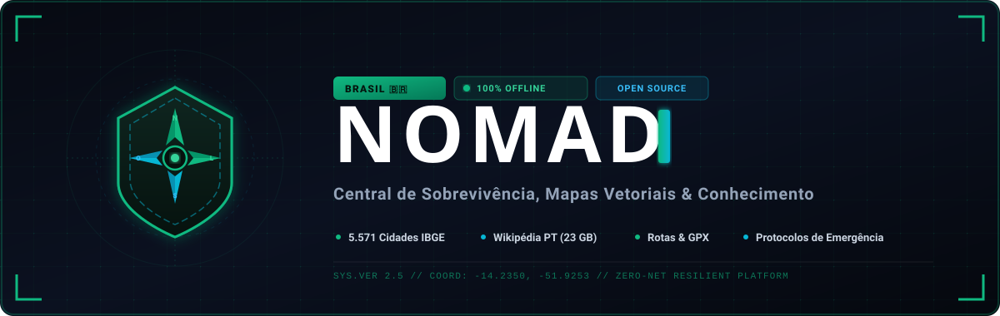

<p align="center">
  
</p>

<p align="center">
  <a href="https://dougpomp.github.io/nomad-brasil/"></a>
  <a href="LICENSE"></a>
  
  
  
</p>

> **Sistema autônomo e resiliente de mapas vetoriais nacionais, rotas táticas de evacuação, enciclopédia completa e 56 módulos de sobrevivência, primeiros socorros e resiliência para o Brasil.**  
> Projetado para operar com **zero dependência de internet**, funcionando diretamente em notebook, HD externo, pendrive ou servidor local de campo (Docker).  
> 🌐 **Demonstração Online no GitHub Pages (PWA):** [https://dougpomp.github.io/nomad-brasil/](https://dougpomp.github.io/nomad-brasil/)

---

## 🧭 Visão Geral

O **NOMAD Brasil** é uma plataforma *open source* criada para prover infraestrutura crítica de informação durante apagões prolongados, catástrofes climáticas, colapso de redes ou operações de campo em áreas remotas do território nacional.

O sistema integra em uma interface tática ultra-rápida em *dark mode*:
- **🗺️ Cartografia Vetorial Offline:** Cobertura do Brasil inteiro via PMTiles (1,57 GB) com MapLibre GL JS, sem depender de nenhum serviço externo.
- **📍 Todos os 5.571 Municípios do IBGE:** Busca instantânea com coordenadas geográficas, DDD e dados estratégicos.
- **🚗 Rotas Táticas Híbridas:** Deslocamento rodoviário, off-road (4x4) e marcha a pé, com cache permanente em disco e exportador **GPX** para Garmin e OsmAnd.
- **📚 Acervo Enciclopédico Kiwix (23+ GB):** Wikipédia em português com imagens, guias médicos militares e manuais de emergência.
- **🛠️ 56 Módulos Especializados:** Guias interativos, calculadoras técnicas e protocolos operacionais para todas as dimensões de sobrevivência e autossuficiência.

---

## 🛡️ Arsenal de Módulos (56 Ferramentas)

### 1. 🗺️ Cartografia, Navegação & Deslocamento
1. **Mapas Nacionais em Nível de Ruas:** Visualizador vetorial acelerado por GPU com camada de relevo e estradas.
2. **Busca dos 5.571 Municípios:** Banco de dados integrado com indexação instantânea offline.
3. **Planejador de Rotas & Evacuação:** Cálculo de consumo de combustível, água e calorias para rotas rodoviárias e a pé.
4. **Waypoints & POIs Estratégicos:** Hospitais, UPAs 24h, Batalhões da PM/Bombeiros (193), PRF, Fontes de Água e Postos 24h.
5. **Bússola Digital & Orientação Natural:** Rumo magnético, orientação solar por sombra de vareta e método analógico do relógio.
6. **Navegação Celeste (Hemisfério Sul):** Localização do Sul verdadeiro pelo Cruzeiro do Sul e constelação de Órion.
7. **Topografia de Expedição & Triangulação:** Leitura de cartas topográficas, cálculo de declividade e triangulação com bússola.
8. **Calculadora de Marcha & Navegação:** Ritmo de marcha militar, equação de Tobler para desníveis e gasto calórico.
9. **Mecânica de Emergência & Desatolamento:** Técnicas de ancoragem com guincho, estepe enterrado (deadman anchor) e reparos em campo.

### 2. 🩹 Primeiros Socorros & Atendimento Pré-Hospitalar (APH)
10. **Protocolos Imediatos de Suporte Básico:** Guias passo a passo para RCP (Parada Cardíaca), Manobra de Heimlich, Queimaduras e Convulsões.
11. **Trauma Grave — Protocolo TCCC / MARCHE:** Aplicação de torniquete tático, curativo compressivo israelense, selo de tórax valvulado e combate à hipotermia.
12. **Animais Peçonhentos do Brasil:** Identificação visual, tipo de veneno (crotálico, botrópico, elapídico) e soro antiofídico correspondente para Jararaca, Cascavel, Surucucu, Coral, Escorpiões e Aranhas.
13. **Fraturas, Luxações & Tração Óssea:** Protocolo de redução e alinhamento com talas rígidas e tração cutânea com teste obrigatório de **PMS** (Pulso, Motricidade, Sensibilidade).
14. **Suturas & Tratamento de Feridas na Mata:** Técnicas de assepsia de campo, aproximação com tiras adesivas, pontos simples e curativos com mel puro.
15. **Odontologia de Emergência & APH Bucomaxilar:** Alívio imediato de pulpite aguda, reimplante de dente avulsionado e hemostasia oral.
16. **Cinotécnica & APH Veterinário Canino (K9):** Parâmetros vitais de cães de trabalho, contenção tática, estancamento e intoxicação canina.
17. **Wikipédia Médica Completa:** Mais de 50.000 artigos médicos e farmacológicos servidos pelo Kiwix.

### 3. 📻 Telecomunicações, Rádio & Sinais de Emergência
18. **Central de Sinais de Socorro & Morse Ativo:** Sinalizador visual estroboscópico de tela, tradutor de texto para Morse e **sintetizador de áudio de 800 Hz** com trava de segurança anti-sobreposição.
19. **Frequências de Socorro do Brasil:** Frequências oficiais do Rádio Cidadão (PX Canal 9 - 27.065 MHz), VHF Marítimo (Canal 16 - 156.800 MHz), RENER (Defesa Civil) e Aviação (121.500 MHz).
20. **Calculadora de Antenas Dipolo:** Dimensionamento milimétrico de dipolos de meia onda utilizando fio comum de cobre.
21. **Código Q Oficial & Alfabeto ICAO:** Dicionário interativo com busca instantânea dos códigos de rádio operacionais.
22. **Sinais Terra-Ar para Resgate (SAR / ICAO):** Painéis e símbolos corporais para comunicação visual com aeronaves e helicópteros.
23. **Cifra Tática & Transmissão Segura:** Encriptação manual com Cifra de César, Cifra de Vigenère e bloco de uso único (One-Time Pad).
24. **Protocolo PACE de Comunicação:** Definição operacional das 4 camadas (Primary, Alternate, Contingency, Emergency) e janelas de escuta.
25. **Satélites Meteorológicos & Ciclo Lunar:** Previsão de passagens de satélites NOAA/GOES e tábua de luminosidade lunar.

### 4. 🌾 Resiliência Alimentar, Água & Agrofloresta
26. **Calculadora Tática de Racionamento:** Dimensionamento exato de água (3 L/dia/pessoa), calorias totais e cesta padrão nacional (arroz, feijão, aveia, sardinha, sal).
27. **Captação, Filtração & Cloração de Água:** Construção de biofiltros de areia/brita e tabela de dosagem de hipoclorito de sódio a 2,5%.
28. **Poço Caipira Manual & Carneiro Hidráulico:** Perfuração manual de poços rasos e montagem de bomba de carneiro sem energia elétrica.
29. **Plantas Alimentícias Não Convencionais (PANC):** Guia botânico de identificação e preparo de Ora-pro-nóbis, Taioba, Beldroega, Dente-de-leão e Caruru.
30. **Conservação Ancestral de Alimentos:** Defumação a frio/quente, cura com sal grosso, banha de porco (confit) e desidratação solar.
31. **Panificação Rústica & Fermentação Selvagem:** Cultivo e manutenção de fermento natural (*levain/sourdough*) e pães de panela de ferro.
32. **Apicultura Nativa & Abelhas Sem Ferrão (ASF):** Criação racional de espécies brasileiras (Jataí, Mandaçaia, Tiúba, Uruçu) e produção de mel medicinal.
33. **Piscicultura & Aquaponia Artesanal (IBC 1000L):** Criação sustentável de tilápias integrada ao cultivo de hortaliças em leito de brita.
34. **Banco de Sementes Crioulas & Hortas de Crise:** Métodos de coleta, secagem, armazenamento hermético em garrafas PET e plantio de subsistência.

### 5. ⚡ Energia, Infraestrutura & Sobrevivência Prática
35. **Calculadora Fotovoltaica Off-Grid:** Cálculo da potência de painéis solares (Wp), dimensionamento do banco de baterias e controlador MPPT.
36. **Baterias 18650 & Geradores Alternativos:** Recuperação de células de lítio, montagem de packs balanceados e geradores mecânicos.
37. **Gasogênio a Lenha (Wood Gas):** Fabricação de gasificador térmico para converter biomassa florestal em combustível de motores a pistão.
38. **Checklist de Mochila 72 Horas (BOB):** Inventário dinâmico dividido nas 7 linhas de resiliência com pesagem total em tempo real.
39. **Plano de Emergência Familiar (PEF):** Definição de rotas primárias de fuga, pontos de encontro (dentro/fora do bairro) e senhas familiares.
40. **Fogo em Condições Severas & Fogueira Dakota:** Técnicas de pederneira com fungo de árvore, fogo de atrito e buraco Dakota (chama invisível sem fumaça).
41. **Construção de Abrigos & Bioconstrução:** Técnicas de pau-a-pique, adobe, superadobe e abrigos rápidos de lona e folhagens.
42. **Manual Tático de Nós & Amarrações:** Nós de salvamento (Ás de Guia), tração (Caminhoneiro), junção (Nó de Escota) e pioneirias com bambu.
43. **Pesca & Armadilhas de Sobrevivência:** Arapucas para aves, laços de gatilho de mola e anzóis improvisados de osso/madeira.
44. **Meteorologia Empírica & Leitura de Nuvens:** Previsão do tempo sem barômetro através de nuvens cumulonimbus, névoa e comportamento animal.
45. **Sinais de Pista & Rastreamento Humano:** Identificação de passadas, leitura de compressão do solo e técnicas de contra-rastreamento.

### 6. 🛡️ Defesa Passiva, Proteção QBRN & Segurança
46. **Evasão Urbana & Conceito Gray Man:** Técnicas de blend-in civil, camuflagem comportamental e dispersão sem chamar atenção.
47. **Segurança Perimetral & Alertas de Intrusão:** Instalação de alarmes passivos de linha de tropeço (*tripwires* com espoleta/latinhas) e setores defensivos.
48. **Fortificação de Abrigos & Defesa Passiva:** Reforço de portas, barricadas de sacos de terra, blindagem balística e compartimentação de cômodos seguros.
49. **Gaiola de Faraday & Proteção EMP:** Construção de blindagens eletromagnéticas com caixas de munição e folhas de cobre para proteger rádios e baterias.
50. **Acidentes Radiológicos & Proteção QBRN:** Protocolos de blindagem radiológica (Tempo, Distância, Blindagem) e descontaminação pessoal.
51. **Biossegurança, Epidemias & Quarentena:** Protocolos de isolamento domiciliar, paramentação de proteção e saneamento básico de dejetos.
52. **Defesa Civil & Desastres Naturais do Brasil:** Procedimentos oficiais em inundações, enxurradas, deslizamentos de encostas e estiagens severas.

### 7. ⚒️ Oficinas Rústicas, Química & Ferramentaria
53. **Forja & Ferraria Rústica:** Montagem de forja de barro/tijolos, soprador de ar com ventoinha e têmpera de ferramentas em óleo.
54. **Cutelaria & Afiação de Campo:** Uso de pedras de rio, chairas e lixas para afiação de facões, machados e navalhas.
55. **Carvão Vegetal Ativado Medicinal & Filtros:** Pirólise controlada de cascas de coco/madeira e ativação com cloreto para uso antitóxico e em filtros.
56. **Química Prática & Sabão de Cinzas:** Saponificação tradicional utilizando lixívia de cinzas de madeira e gordura animal.
- **Cartão Tático de Bolso Imprimível (A4 Dobrável):** Folha única ultra-compacta contendo todas as frequências vitais, ficha médica, nós e protocolos de choque.
- **Pacote Portátil Offline:** Exportação compacta em arquivo único para armazenamento seguro em pen-drives criptografados.

---

## ⚡ Instalação Rápida (1 Clique)

### No Windows:
1. Clone o repositório ou baixe os arquivos para o seu computador:
   ```cmd
   git clone https://github.com/DougPomp/nomad-brasil.git
   cd nomad-brasil
   ```
2. Execute o instalador automático com 2 cliques ou pelo terminal:
   ```cmd
   setup-nomad-brasil.bat
   ```
   *O instalador cria a estrutura de diretórios, baixa o mapa vetorial do Brasil (`brazil-streets.pmtiles`), oferece o download da Wikipédia Kiwix e inicia os contêineres Docker automaticamente.*

3. Para inicializações diárias rápidas:
   ```cmd
   iniciar-nomad-brasil.bat
   ```

### No Linux / macOS / Raspberry Pi:
```bash
git clone https://github.com/DougPomp/nomad-brasil.git
cd nomad-brasil
chmod +x setup-nomad-brasil.sh
./setup-nomad-brasil.sh
```

---

## 🌐 Portas de Acesso Local

| Serviço | Endereço | Descrição |
| :--- | :--- | :--- |
| **Portal NOMAD Brasil** | [http://localhost:8000](http://localhost:8000) | Dashboard tático, mapa vetorial, rotas e 56 módulos de sobrevivência |
| **Biblioteca Kiwix** | [http://localhost:8090](http://localhost:8090) | Servidor e leitor nativo dos acervos ZIM da Wikipédia |

---

## 🛠️ Arquitetura do Sistema

```
nomad-brasil/
├── app/
│   ├── server.js               # Servidor HTTP Node.js com streaming Range 206 e rotas
│   ├── data/
│   │   ├── cities.json         # Todos os 5.571 municípios do IBGE (UTF-8, DDD, Lat/Lng)
│   │   ├── emergencies.json    # Protocolos de atendimento pré-hospitalar
│   │   ├── pois.json           # POIs estratégicos (Hospitais, Bombeiros, PRF, Água, Postos)
│   │   ├── radio_frequencies.json # Frequências oficiais (PX, VHF, Marítimo, Código Q)
│   │   ├── survival.json       # Manuais técnicos de resiliência e campo
│   │   └── routes_cache/       # Cache permanente em disco de todas as rotas traçadas
│   └── public/
│       ├── index.html          # Interface tática em dark mode com os 56 módulos
│       ├── styles.css          # Design system com sidebar tática e controles escuros
│       ├── app.js              # Lógica de mapas, busca, rotas, POIs, áudio Morse e estoque
│       ├── sw.js               # Service Worker PWA para operação 100% offline
│       ├── banner.svg          # Banner vetorizado da marca
│       ├── logo.svg            # Logotipo oficial
│       └── vendor/             # MapLibre GL e PMTiles 100% offline (zero CDNs)
├── docs/                       # Demonstração Web PWA no GitHub Pages
│   ├── index.html              # Showcase completo das ferramentas táticas
│   ├── sw.js                   # Service Worker do GitHub Pages (v7)
│   ├── manifest.json           # Manifesto PWA instalável em smartphones e tablets
│   ├── banner.svg              # Imagem Open Graph / Twitter Card
│   └── logo.svg                # Favicon e ícones
├── storage/
│   ├── maps/
│   │   ├── brazil-streets.pmtiles      # Arquivo vetorial (1,57 GB, 1.186.952 tiles)
│   │   └── basemaps-assets/fonts/      # Glyphs Noto Sans locais
│   └── zim/
│       ├── wikipedia_pt_all_maxi.zim   # Wikipédia Completa em Português
│       └── kiwix-library.xml           # Catálogo XML gerado
├── tools/                      # Utilitário go-pmtiles
├── docker-compose.yml          # Orquestração dos serviços (Web e Kiwix)
├── setup-nomad-brasil.bat      # Instalador e downloader automático para Windows
├── setup-nomad-brasil.sh       # Instalador e downloader automático para Linux/macOS
├── iniciar-nomad-brasil.bat    # Inicializador rápido portátil (%~dp0)
└── README.md
```

---

## 🚗 Sistema de Rotas Táticas (Híbrido)

O sistema possui tripla camada de resiliência para cálculo de deslocamentos:
1. **Camada 1 — Rodovias Reais (Online/OSRM):** Traçado geográfico fiel às rodovias federais e estaduais (Bandeirantes, Anhanguera, Dutra, BR-101, BR-116, etc.) com guia curva a curva.
2. **Camada 2 — Cache Permanente em Disco:** Qualquer rota pesquisada uma única vez é gravada localmente em `app/data/routes_cache/`. Se a internet for cortada, a rota continua disponível instantaneamente para sempre.
3. **Camada 3 — Corredor Tático de Contingência (Zero Conexão):** Em caso de rota inédita em área sem sinal, o motor interno calcula o corredor rodoviário aproximado entre as cidades com fator de curvatura real do Brasil (1,28x) e indica cidades de apoio no percurso.
4. **Exportação GPX:** Qualquer rota calculada pode ser salva em arquivo `.gpx` para uso em aparelhos GPS Garmin ou aplicativos offline em smartphones (OsmAnd, Organic Maps).

---

## 📋 Requisitos Mínimos

- **Sistema Operacional:** Windows 10/11, Linux (Ubuntu, Debian, Fedora, Arch) ou macOS.
- **Hardware:**
  - Processador: Dual-core 2.0 GHz ou superior (compatível com Raspberry Pi 4 / 5).
  - Memória RAM: Mínimo 2 GB (o contêiner consome menos de 70 MB).
  - Armazenamento:
    - ~3 GB (Instalação básica com Mapas do Brasil e Wikipédia Médica).
    - ~30 GB (Instalação completa com Wikipédia Maxi 2026 de 23 GB com fotos).
- **Software:** Docker Engine / Docker Desktop instalado e ativo.

---

## 📄 Licença

Este projeto é disponibilizado sob a licença **MIT** — livre para uso pessoal, comunitário, acadêmico e corporativo.
